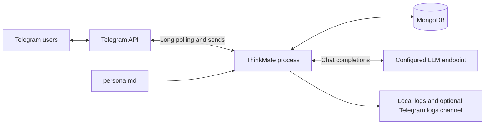
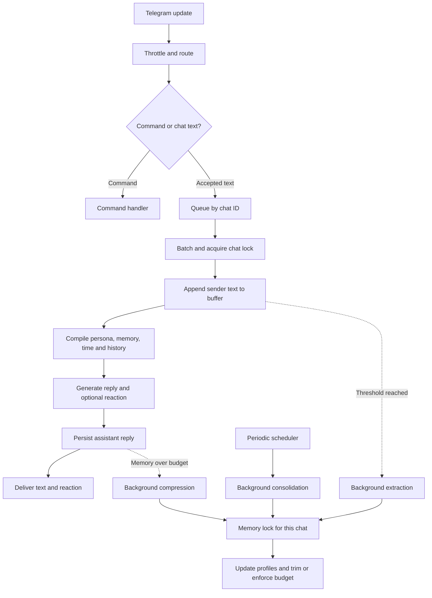

# Architecture

[Documentation index](README.md) · [Repository map](repository_structure.md) · [Memory engine](development/memory_engine.md)

ThinkMate is a single asynchronous Python process. aiogram receives Telegram updates through long polling; Motor accesses MongoDB; the OpenAI SDK sends requests to the configured LLM endpoint. The bot maintains structured memory and injects it into prompts. It does not train models or retrieve embeddings.

## System boundary

MongoDB and the LLM are external services even when they run on the same machine. The supplied Docker image contains only the bot, with no public HTTP endpoint or bundled database.

## Two kinds of work

The **reply path** handles the current conversation. The **memory path** runs extraction, compression, and scheduled consolidation in background tasks. Both use the same LLM service; the distinction describes scheduling and purpose rather than separate model training.

There is no arrow from extraction completion to reply generation: replies continue without waiting for new memory. They may use the previous profile while extraction is running.

## A conversational turn

1. [Middleware](../app/handlers/middlewares.py) tracks the active handler for shutdown, applies a per-user sliding-window throttle and a startup-anchored age guard, then injects the shared database handle. This handle is not a MongoDB transaction/session.
2. [Message routing](../app/handlers/messages.py) ignores unsupported/senderless updates, enforces the text input limit, and selects private or group behavior. Commands are handled by their own router.
3. [UserTaskManager](../app/services/user_task_manager.py) queues text by chat ID and coalesces consecutive messages from the same sender. Group batches preserve arrival order, including an A → B → A sequence, under the chat's reply lock.
4. [chat_manager](../app/services/chat_manager.py) appends text and uses the returned buffer snapshot for history. It checks the stored item count to choose the normal or new/sparse-profile extraction threshold.
5. It compiles memory and the cached persona. Private chats add the previous-interaction gap; groups add named history, speaker instructions, shared group memory, and the triggering sender's personal memory. Both paths include current time context.
6. [LLMService](../app/services/llm_service.py) makes a logical reply-bundle request for text and reaction, plus an optional affinity adjustment in groups. Retries can make that more than one HTTP attempt.
7. The assistant reply is capped before it is stored and sent to Telegram. [Delivery](../app/services/user_task_manager.py) applies optional reactions and splits text with [telegram_text.py](../app/services/telegram_text.py). A stored assistant reply does not prove that Telegram delivered it.
8. Extraction and compression are scheduled when needed. Reply locks serialize conversations locally; they do not block concurrent users.

Batch delay and extraction thresholds are tunable. The coalescing timer waits until the idle delay or maximum batch age, whichever comes first. This bounds batching delay, not lock waits, generation, or delivery. See [performance](development/performance_and_scaling.md).

## Memory lifecycle

| Stage | Trigger and result |
| --- | --- |
| Buffering | Store recent text under chat ID with a hard entry cap. A buffer persists across process restarts. |
| Extraction | At the character threshold, process older entries while retaining the newest configured number. Save structured updates and remove only entries from the extraction snapshot by unique message ID; legacy arrays use conditional replacement. |
| Compression | When compiled memory exceeds the configured budget, condense its arrays/summary, then apply deterministic shedding. |
| Consolidation | A periodic scan finds eligible profiles and revisits the complete memory to merge/update it and add insights. |
| Proactive check-in | A separate scheduler finds eligible inactive private-chat users and generates a memory-grounded opener. |

The buffer hard cap and extraction's final failure trim can discard text before useful memory is extracted. The compiled memory budget is a target for the memory block, not a hard bound on the entire LLM context. Protected profile fields can keep a memory block over budget. See [memory engine](development/memory_engine.md) for exact conditions and failure behavior.

## Storage and sharing boundaries

| Record | Key | Meaning |
| --- | --- | --- |
| Personal profile | `user_profiles._id = user_id` | Memory shared for that user across their conversations. |
| Shared group profile | `user_profiles._id = chat_id` | Group context, separate from participant profiles. |
| Conversation buffer | `chat_buffers._id = chat_id` | Recent messages for a private chat or group. |
| Group member | `chat_members._id = "chat_id:user_id"` | Per-group affinity and member mode. |
| LLM audit | `user_id` plus timestamp | Diagnostic call records; group calls use the group chat ID. |
| Metrics snapshot | Singleton in `metrics_state` | Aggregate counters/timers restored on restart. |

Keyed records prevent accidental unscoped lookups, but they do not guarantee private/group confidentiality. Group prompts deliberately include the triggering user's global profile, group extraction updates participant profiles, and `/profile` may be invoked in a group. Reset also has a narrower scope than complete erasure. See [database](development/database.md) and [groups](development/group_chat.md).

## Concurrency and lifecycle

`UserState` contains a queue, batch/typing tasks, `chat_lock`, and `memory_lock`. States are keyed by chat ID. The reply lock serializes generation within a conversation; the memory lock coordinates extraction/compression/consolidation for that same key.

These locks exist only in this process. Memory writes also compare their source profile snapshots before applying updates, protecting participant profiles from stale replacement across conversations. Extraction retries against current memory after a conflict; maintenance skips stale replacement. Captured profile-generation tokens reject results after that profile is deleted or recreated. Confirmed reset stops prior owned DM work and holds new DM messages through backup/deletion. Updates across collections are not transactional, and retained shared group history remains.

[main.py](../main.py) starts configured schedulers and explicitly deletes the Telegram webhook with pending updates before polling. Its cleanup runs after polling or startup failure: stop schedulers, drain active update handlers for up to 10 seconds, drain conversation tasks for another 10 seconds, drain LLM audit tasks for up to 5 seconds and close the LLM client, then flush metrics and logs before closing Telegram and MongoDB. The error sink has a separate 5-second drain; asynchronous cleanup steps have a 15-second outer timeout. Outstanding tasks are cancelled after their drain window. Crashes and forced termination can still lose in-memory work.

Run one process per bot token. Distributed workers/webhooks, a global LLM concurrency ceiling, and complete deletion semantics require additional design; see [scaling](development/performance_and_scaling.md) and [roadmap](roadmap.md).

## Where to go next

Use the [repository map](repository_structure.md) to locate code, [operations](operations.md) to deploy and diagnose it, and [safeguards](development/hardening_plan.md) to distinguish protections from remaining gaps.
